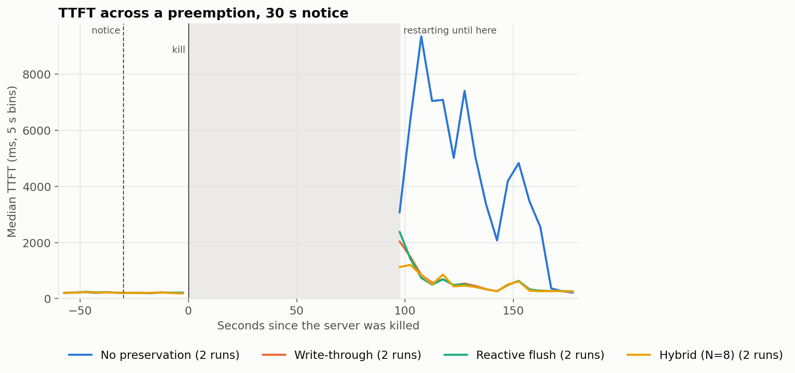
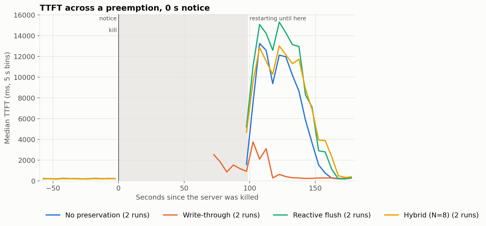
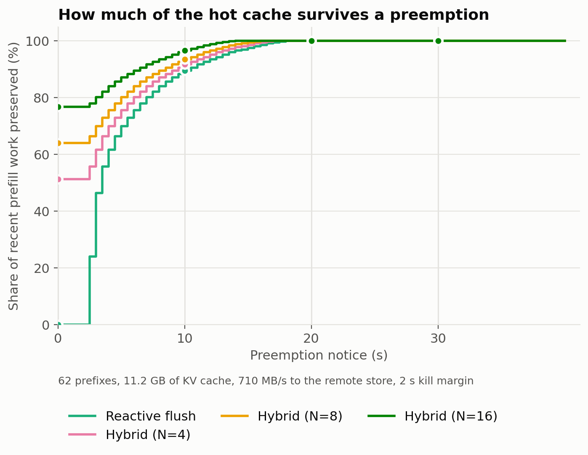
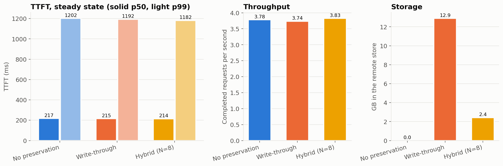

# Midterm checkpoint (Wed Nov 11): content for the 8 slides

Everything needed for the slides, in slide order. Numbers come from `results/README.md`,
`results/run_log.csv` and `results/midterm_*.csv`; figures from `bash analysis/make_figures.sh`.
Runs: 2026-11-10, high-reuse workload, 4 req/s, 2 repeats per configuration.

## Slide 1: Recap: problem and research question

- Spot GPUs cost much less than on-demand, but can be preempted with little or no notice
  (GCP gives about 30 s; sometimes effectively 0).
- An LLM server's prefix KV cache (shared system prompts, chat history) lives in GPU and host
  memory. A preemption loses it, and every returning request has to recompute its context: a TTFT spike.
- **Question:** which way of preserving the cache in a durable store gives the best recovery for its
  cost, and how does that depend on notice length?

| Strategy | Idea |
|---|---|
| No preservation | Lose everything; recompute on the replacement |
| Write-through | Copy every chunk to the durable store as it is made |
| Reactive flush | On notice, save the hottest prefixes that fit in the window |
| Hybrid (N = 8) | Keep the top N hot prefixes replicated all the time, plus reactive flush on notice |

## Slide 2: System built

```
                    kv-gpu  (GCP g2-standard-8, 1x NVIDIA L4 24 GB, us-central1-a)
  workload_gen.py ──HTTP──▶ vLLM 0.32  ─ GPU prefix cache (~3.9 GB KV, ~23 prefixes)
  (high-reuse,              │
   4 req/s)                 └─ LMCache 0.5.7 connector ─ CPU tier (10 GB host RAM)
       ▲                                │  write-through, 256-token chunks
       │ request log (CSV)              ▼
  emulator/preempt.py ──────────▶ Redis 6 on kv-store (n2-highmem-4, same zone)
   notice · policy · kill ·        durable KV store, 24 GB, internal network only
   delete · restart                       ▲
       │                                  │ keep/delete by prefix
       └── policy/policy.py: rank_prefixes → select_prefixes
```

- Model: Qwen2.5-7B-Instruct, bf16. KV is 57,344 B/token; checked against LMCache's stored bytes
  (176 MB stored vs. 180 MB estimated per prefix, ratio 0.98).
- Everything works end to end:
  - prefix caching on the GPU;
  - LMCache saving KV to CPU memory and to Redis;
  - a restarted server loading KV back from Redis (8,448 of 8,448 tokens, TTFT 2.6 s → 1.5 s).
- Pinned versions and every setup fix: `infra/requirements-gpu.lock.txt`, `infra/TROUBLESHOOTING.md`.

### Workload and policies

- **Workload** (`workload/workload_gen.py`, high-reuse):
  - 64 shared system prompts of about 3,140 tokens each, with Zipf(1.1) popularity;
  - one short question per request, 64 output tokens, Poisson arrivals at **4 req/s**;
  - logs `prefix_id`, send time, TTFT, end-to-end latency and exact `prompt_tokens` per request.
  - A ShareGPT multi-turn workload and a low-reuse control are implemented for after the midterm.
- **Hotness** (`policy/policy.py`) = requests for a prefix in the last 300 s × its length in tokens.
  Ties go to the larger prefix.
- **Reactive flush:** budget = 0.71 GB/s × (notice − 2 s). Walk prefixes hottest first, keep each that
  still fits (skip-and-continue).
- **Hybrid:** the top N prefixes are always kept (replicated every 30 s in the background); the rest
  of the budget works like reactive flush.

### Preemption emulator

One run (`emulator/preempt.py run`), every step timestamped into `events.json`:

1. **Fresh start:** stop vLLM, empty Redis, start vLLM with write-through to Redis.
2. **Serve** the high-reuse workload for 180 s.
3. **Notice** (`t_notice`): the policy ranks prefixes from the request log and picks what to keep.
4. **Notice window:** 0 / 30 / 120 s; vLLM keeps serving.
5. **Kill** (`t_kill`): stop vLLM. Process exit frees GPU memory and LMCache's CPU tier.
6. **Keep what the strategy saved:** delete from Redis every chunk of the prefixes the strategy
   wouldn't have saved.
7. **Replacement** (`t_restart` → `t_ready`): start vLLM; the workload keeps sending throughout.
8. **Serve 180 s more**; record `t_first_served` and the TTFT recovery.

| Strategy | What survives in the store |
|---|---|
| No preservation | nothing |
| Write-through | everything written so far |
| Reactive flush | `select_prefixes(..., hot_set_n=0)`: hottest prefixes that fit in bandwidth × (notice − 2 s) |
| Hybrid (N = 8) | top 8 always (replicated in advance), plus what fits in the window |

**Emulated, and the slides should say so:**
- The replacement is a vLLM restart on the same VM. A real VM start adds about 54 s (allocation)
  plus 12 s (boot), and loads weights from a cold disk.
- Reactive and hybrid get "what they would have saved" by deleting from a write-through store,
  using the measured 0.71 GB/s. The flush itself isn't timed live.
- Steady-state hybrid replicates the hot set as same-sized values: real traffic and storage, but not
  LMCache's own chunks.

### Methodology

- **Why 4 req/s:** a rate probe on a warm server gave a median TTFT of 193 / 261 / 395 ms at
  2 / 4 / 6 req/s, and about 29 s at 10 req/s (just queueing). 4 req/s leaves headroom, so a
  preemption's spike is visible.
- **Hot set:** 64 × 12 chunks × 14.7 MB = **11.3 GB**. It exceeds the GPU cache (~3.9 GB) and the
  CPU tier (10 GB); the Redis store holds all of it.
- **Configurations:** no preservation and write-through at 0 and 30 s; reactive and hybrid (N = 8) at
  0 / 30 / 120 s. Each runs twice, with workload seeds 1 and 2. None and write-through save the same at
  any notice, but running them at both 0 s and 30 s means each comparison has every strategy killed at the
  same point in the same request stream.
- **Steady state:** no preemption, 60 s warmup plus 240 s measured, for none (CPU tier only),
  write-through (CPU tier + Redis) and hybrid (CPU tier + background replication every 30 s).
- **Metrics:**
  - TTFT p50/p99 before the notice and in the first 60 s after the replacement is ready;
  - kill → first request served;
  - share of the hot set kept, by bytes and by recent requests (the last 300 s);
  - GB kept, store bytes, throughput.

## Slide 3: Result: TTFT over time across a preemption





Median TTFT in 5 s bins, both repeats pooled, aligned on each run's kill. The shaded band is the
median restart time; write-through at 0 s came back a little sooner (86 s downtime vs. ~98 s), which is
why its line starts inside the band. A 120 s figure (`figures/ttft_120s.png`) looks the same as 30 s.

| Strategy | Notice | Hot-set bytes kept | Recent requests covered | GB kept | TTFT p50 before | TTFT p50 after | TTFT p99 after | Kill → first served |
|---|---|---|---|---|---|---|---|---|
| No preservation | 0 s | 0% | 0% | 0 | 221 ms | 8,738 ms | 14,872 ms | 103 s |
| Write-through | 0 s | 100% | 100% | 11.0 | 219 ms | 692 ms | 4,667 ms | 91 s |
| Reactive flush | 0 s | 0% | 0% | 0 | 220 ms | 12,073 ms | 17,808 ms | 105 s |
| Hybrid (N=8) | 0 s | 13% | 63% | 1.4 | 218 ms | 9,843 ms | 14,542 ms | 111 s |
| No preservation | 30 s | 0% | 0% | 0 | 218 ms | 5,918 ms | 9,727 ms | 105 s |
| Write-through | 30 s | 100% | 100% | 11.0 | 219 ms | 541 ms | 2,200 ms | 100 s |
| Reactive flush | 30 s | 100% | 100% | 11.0 | 221 ms | 524 ms | 2,489 ms | 101 s |
| Hybrid (N=8) | 30 s | 100% | 100% | 11.0 | 218 ms | 534 ms | 1,874 ms | 101 s |
| Reactive flush | 120 s | 100% | 100% | 11.0 | 222 ms | 538 ms | 3,009 ms | 106 s |
| Hybrid (N=8) | 120 s | 100% | 100% | 11.0 | 220 ms | 513 ms | 1,898 ms | 101 s |

2 runs per row. "After" is the first 60 s once the replacement is ready. Kill → ready is about 98 s in
every run (emulated restart). Compare 0 s rows with each other and 30 s rows with each other.

Hybrid at 0 s, after the restart, split by whether a request's prefix was kept: **kept 9,790 ms vs.
lost 9,956 ms** (median, first 60 s).

### Diagnostic: the same 0 s preemption at 2 req/s (1 run each, seed 1)

At 2 req/s the replacement can recompute faster than requests arrive.

| First 60 s after restart, median TTFT | 4 req/s | 2 req/s |
|---|---|---|
| No preservation | 8,971 ms | 906 ms |
| Hybrid N=8, all requests | 9,536 ms | **633 ms** |
| Hybrid, requests whose prefix was kept (66% of requests) | 9,104 ms | **368 ms** |
| Hybrid, requests whose prefix was lost | 10,146 ms | 1,396 ms |

**This confirms head-of-line blocking.** With spare capacity, hybrid's kept prefixes are served about 4× faster
than lost ones, and hybrid beats no preservation. At 4 req/s, the recompute backlog makes kept requests wait too.

## Slide 4: Result: cache preserved vs. notice length



From the request log at a real notice (run hybrid30-r1), at the measured 0.71 GB/s.

| Notice | Reactive flush | Hybrid N=4 | Hybrid N=8 | Hybrid N=16 |
|---|---|---|---|---|
| 0 s | 0% | 51% | **64%** | 77% |
| 10 s | 90% | 92% | 94% | 97% |
| 20 s, 30 s, 120 s | 100% | 100% | 100% | 100% |

- The model matches the runs: hybrid N=8 at 0 s is 64% here and 63% measured.
- Everything fits from about 18 s of notice, so **at 30 s and 120 s every strategy except
  no preservation keeps the whole hot set.** The strategies only differ below ~18 s.
- N trades steady-state storage for 0 s coverage: each doubling of N adds about 13 points.

## Slide 5: Result: steady-state overhead



| Strategy | TTFT p50 / p99 | E2E p50 / p99 | Throughput | Store used |
|---|---|---|---|---|
| No preservation (CPU tier only) | 217 / 1,202 ms | 2,543 / 6,256 ms | 3.79 req/s, 120 tok/s | 0 GB |
| Write-through (CPU tier + Redis) | 215 / 1,195 ms | 2,441 / 6,404 ms | 3.74 req/s, 114 tok/s | **12.9 GB** |
| Hybrid N=8 (CPU tier + replication) | 214 / 1,182 ms | 2,507 / 5,924 ms | 3.83 req/s, 115 tok/s | **2.4 GB** (2.2 GB replicated, 12 prefixes over time) |

1 run per strategy, 240 s measured after a 60 s warmup.

### Replacement startup time and store bandwidth

| Measurement | Value |
|---|---|
| Redis write, 1 connection (`BANDWIDTH_BPS`) | **0.71 GB/s** |
| Redis read, 1 connection | **0.37 GB/s** |
| Raw network, kv-gpu ↔ kv-store | 1.7 GB/s write, 1.2 GB/s read |
| GCP start (capacity + power on) | 54 s |
| OS boot | 12 s |
| vLLM ready, cold disk | 160 s (74 s weights, 34 s engine init) |
| **Real VM start → serving** | **~230 s** |
| Emulated restart (warm page cache) → ready | ~70 s (`downtime_s` ≈ 98 s from kill, including shutdown) |
| L4 capacity wait on restart (2026-11-10) | **69 min** stockout in us-central1-a |

- Redis is the bottleneck, not the network: it handles commands on one thread.

## Slide 6: Takeaways so far

1. **A preemption with nothing preserved costs a long TTFT spike.** The median goes from about 220 ms to
   6–9 s in the first minute, and recovery takes about 45 s after the replacement is ready.
2. **Anything that keeps the hot set recovers almost at once:** about 0.5 s median in the first minute.
   - With 30 s of notice, reactive flush keeps everything, because 0.71 GB/s × 28 s ≈ 20 GB is more
     than the 11.3 GB hot set.
   - So at 30 s and 120 s notice, **reactive, hybrid and write-through are equivalent here.** The
     differences come at 0 s notice and in steady-state cost.
3. **At 0 s notice, reactive saves nothing** and behaves like no preservation, as expected.
4. **Hybrid at 0 s keeps the prefixes of 63% of recent requests (13% of the bytes), but TTFT barely
   improves**, even for the requests whose prefix was kept (9.8 s vs. 10.0 s).
   - The cause is head-of-line blocking: the replacement is swamped recomputing the 56 lost
     prefixes, and requests are served first come, first served.
   - At 2 req/s the effect appears: kept-prefix requests get 368 ms vs. 1,396 ms for lost ones, and
     hybrid beats none overall (633 vs. 906 ms). So **the hybrid's benefit at 0 s notice depends on
     spare capacity on the replacement.** Prioritizing cache-hit requests in the scheduler, or
     over-provisioning the replacement, is a natural follow-up.
5. **The steady-state latency and throughput overhead of write-through is too small to measure at
   this load.** LMCache writes asynchronously, and Redis absorbs about 1 MB/s of new chunks. **The cost
   difference is storage: write-through holds 12.9 GB vs. hybrid's 2.4 GB (5.3× less).** That's the
   main input to the cost model.

## Slide 7: Remaining plan (Nov 12 – Dec 2)

- **Weeks 7–8:** full runs (4 strategies × high-reuse / ShareGPT / low-reuse × 0 / 30 / 120 s, 3 repeats);
  a larger hot set or lower bandwidth so that notice length really constrains reactive flush; test
  serving cache hits first on the replacement; cost model ($ per 1M tokens vs. preemption rate, from
  GCP spot/on-demand prices, storage and egress).
- **Weeks 9–10:** final figures, demo video of a preemption and warm restart, report, slides by Nov 30,
  dry run Dec 1.
- Full checklist: `docs/plan.md`.

## Slide 8: Risks and open questions

- **Downtime is emulated:** about 98 s here vs. about 230 s for a real replacement VM, and a capacity
  wait can be far longer (69 min measured). Longer downtime makes preservation matter more, not less.
- **The post-restart transient is noisy.** Even with matched kill times, none@0 (8.7 s) and reactive@0
  (12.1 s), which keep exactly the same thing, differ by about 40%. Two repeats is the minimum; we'll run 3.
- **At this bandwidth, 30 s of notice saves everything**, so ordering only matters below ~18 s. Is a
  bigger hot set (longer contexts, more prefixes) the realistic case to test?
- **Head-of-line blocking** decides whether a partial save helps. Is changing the scheduler in scope?
- One model, one GPU type, one workload so far; steady state has 1 run per strategy.
